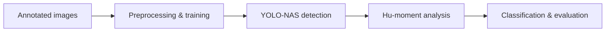

# HuYOLO-NAS
### Computer vision for recyclable waste detection

**YOLO-NAS + Hu Moments · Object Detection · Applied Research**

[Overview](#overview) · [Approach](#technical-approach) · [Evaluation](#evaluation) · [Repository files](#repository-contents)

---

## Overview

**HuYOLO-NAS** is a research prototype for detecting and classifying recyclable solid waste in visual scenes. It investigates the combination of a **YOLO-NAS object detector** with **Hu image moments** to address variation in appearance and localization.

The work focuses on four material categories: **paper, cardboard, PET plastic, and rigid plastic**. It was developed and evaluated using an annotated dataset of **8,400 images**.

> **Scope:** This repository documents an experimental computer-vision approach. It does not claim production readiness, autonomous sorting performance, or verified real-world deployment.

## Research problem

Waste scenes often feature overlapping objects, varied lighting, different shapes and backgrounds. These conditions complicate reliable recognition and create challenges for automated classification.

The objective of this research is to explore how deep-learning detection and shape descriptors can complement one another in a recyclable-material classification workflow.

## Technical approach

| Component | Purpose |
|:--|:--|
| YOLO-NAS | Learned visual object detection and localization |
| Hu moments | Shape-oriented image descriptors |
| Python / Jupyter | Experimentation and analysis |
| Annotated images | Training and evaluation material |
| Evaluation metrics | Precision, recall, F1, accuracy, and mAP |

The diagram presents the conceptual workflow; consult the notebook for its implemented details and experiment settings.

## Dataset

**EcoSight:** 8,400 annotated images covering the four recyclable-material categories above. Dataset redistribution rights and complete availability are **not established by this README**; check permissions before reuse.

## Evaluation

The research considered **precision, recall, F1-score, accuracy, mean Average Precision (mAP), and confusion-matrix analysis**.

No numeric benchmark is stated here without a referenced experiment. Readers should consult the notebook and supplied experiment outputs before citing a specific result.

## Repository contents

| File | Contents |
|:--|:--|
| [`HuYOLO_NAS.ipynb`](HuYOLO_NAS.ipynb) | Main research and experimentation notebook |
| [`HuArm.ino`](HuArm.ino) | Accompanying Arduino sketch |
| [`resultados de prueba`](resultados%20de%20prueba) | Experiment notes/results provided in the repository |

## Reproducing the work

1. Open the notebook and review imports, dependencies, and dataset-path assumptions.
2. Obtain the dataset through an appropriately authorized source.
3. Configure the environment and verify compatible dependencies.
4. Run the notebook in order and inspect each result.
5. Record dataset split, hardware, package versions, and random seeds when comparing experiments.

> A fully reproducible, one-command environment has not been established in this repository. Avoid assuming the notebook is directly executable without configuration.

---

**Applied computer vision · Environmental technology · Machine learning**

Developed by [Wilder Reyes](https://github.com/Wilder-reyes).

